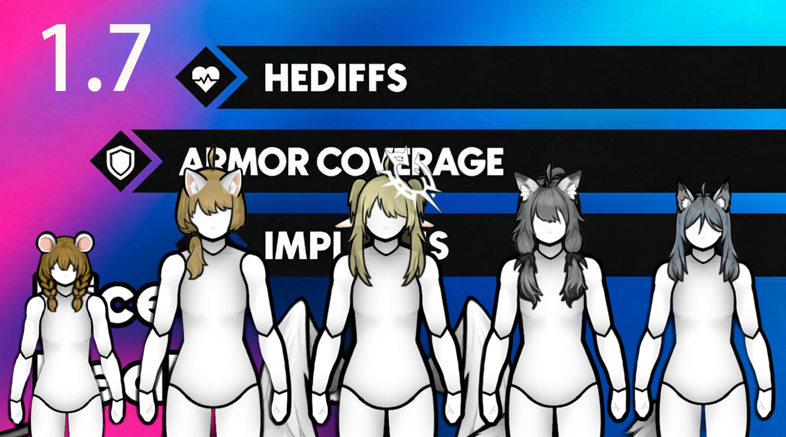

<p align="center">
  
</p>

# Nice Health Tab - Custom Race Dolls

给 [Nice Health Tab](https://steamcommunity.com/sharedfiles/filedetails/?id=3328729902)（NHT）的解剖面板换上**种族专属的娃娃、发型与身体部位**，并附带一个网页编辑器，方便自己制作与导出。

- 为不同种族替换 NHT 面板里的身体，互不干扰；
- 支持种族自带的翅膀、尾巴、角、光环、天线、提灯等装饰部位；
- 重做了 HAR 与「原版发型」两套头发渲染，带阴影/高光、呆毛与头部锚定；
- 游戏内提供齿轮窗口，可实时微调发型位置与大小；
- 自带中文 / English 文本。

## 目前内置种族

| 种族 | 头发类型 | 备注 |
| --- | --- | --- |
| Milira race | HAR 附加件 | 含光环、翅膀、呆毛 |
| Miho race | HAR 附加件 | |
| Kiiro race | HAR 附加件 | |
| Wolfein race | HAR 附加件 | |
| Ratkin race | 原版 HairDef | 可开启发色重绘 |
| Monolyn (MNRace) | HAR 附加件 | 含天线、提灯 |
| Axolotl (MoeLotl) | 原版 HairDef | |
| NHT 默认体型（男/女/胖/壮/幼） | — | 可单独指定是否使用种族娃娃 |

仍在陆续补充其它种族。

## 功能

**娃娃与部位**
- 按种族自动替换 NHT 的身体，支持按「默认 / 男 / 女 / 指定体型」分别选娃娃，或用回 NHT 原版体型；
- 种族自带部位（翅膀 / 尾巴 / 角等）直接绑定它自己的序号；人类共有部位沿用 0–63，编辑器按对照表自动换算；
- 64 号之后的部位同样支持，受伤信息与悬停提示正常；
- 支持「置顶重画 / 联动置顶」与独立置顶层级，处理头发与耳朵、装饰的前后遮挡。

**头发**
- HAR 头发按层级插入到部位之间，耳朵、角等层级更高的部位可以自然盖在头发上；
- 支持带 `alignWithHead` 的头发按头部锚定，换体型不会掉到脸上；
- 支持呆毛（Ahoge）独立层；
- 非 HAR（原版 HairDef）种族可开启「按发色重绘」，保留贴图自带的阴影 / 高光；关闭色彩显示时显示黑白原色，明暗仍在。

**颜色**
- 「部位颜色」总开关：编辑器里标记过的部位可切换为灰度贴图；
- 每个种族的发色显示可单独开关；
- 「色彩显示」在小窗口里是合并开关，并按小人独立保存。

**游戏内齿轮窗口**
- 解剖面板人体区域右下角的 Settings 图标，点击实时调整当前头发；
- 缩放 / 左右 / 上下实时生效，关闭窗口再打开保留；
- 「与全族同步」按小人开关：
  - 关闭：只影响当前小人；
  - 打开：缩放/偏移、使用自定义坐标、色彩显示一起同步到全族；
- 「重置」：开启同步时重置全族，否则只清当前小人的调整；
- 自动校正发型错位：首次打开面板检测头发与头顶偏差，偏差过大才校正，结果按「种族 + 小人」缓存。

**编辑器**
- 仓库自带网页编辑器：双击 `Editor/启动编辑器.bat`，会开一个本地服务并自动打开浏览器；
- 流程：**导入种族 → 调整部位 / 发型 → 注入模组或导出模组文件**；
- 支持：种族导入与素材整理、HAR / 非 HAR 发型自动识别、发型预览与吸附头部、部位多选注入、灰色贴图生成、导出纯模组 zip（自动重建补丁、写入版本号）；
- 编辑器能处理大部分对照问题（部位编号换算、发型参数、缺贴图提示等），界面功能较多，第一次用建议先看编辑器里的「指南」。

## 安装

1. 需要 **RimWorld 1.7**（目前在该版本测试通过）；
2. 必需前置：**Harmony**、**Nice Health Tab**；
3. 与 **HAR（Humanoid Alien Races）** 一起使用时，请让 HAR 排在本模组**之前**加载；
4. 把本模组放进 `Mods/`，在模组列表启用即可。

## 设置

`选项 → 模组设置 → NHT Custom Dolls`，分为：

- **显示**：X 光视图显示头发、画出所有发型层；
- **颜色**：部位颜色、非 HAR 发色重绘、HAR 发色显示、说明；
- **坐标**：非 HAR 自定义坐标、自动校正、重新检测、HAR 游戏内坐标；
- **调试**：日志开关；
- **种族与娃娃**：逐种族指定默认 / 男 / 女 / 体型。

更详细的说明见模组根目录的 `说明.txt`。

## 编辑器截图


## 目录结构

```
About/                 模组信息与预览图
Assemblies/            模组 DLL
Defs/                  默认发型参数等
Patches/nht-*.xml      编辑器注入的种族娃娃补丁
Textures/              编辑器推送的贴图
Languages/             中英文文本
Editor/                网页编辑器（anatomy-editor.html + 本地服务脚本）
Source/                C# 源码 + build.ps1
说明.txt               设置与常见问题说明
```

## 版本

- 当前在 **1.7** 环境下测试通过；
- 编辑器导出的补丁带有版本号，可在导出时填写。

## 授权与致谢

- 补丁与贴图版权归原作者；本仓库只放娃娃数据与绘制逻辑；
- 基于 [Nice Health Tab](https://steamcommunity.com/sharedfiles/filedetails/?id=3328729902) 制作；
- 如原作者有异议，请联系我移除相关内容。
